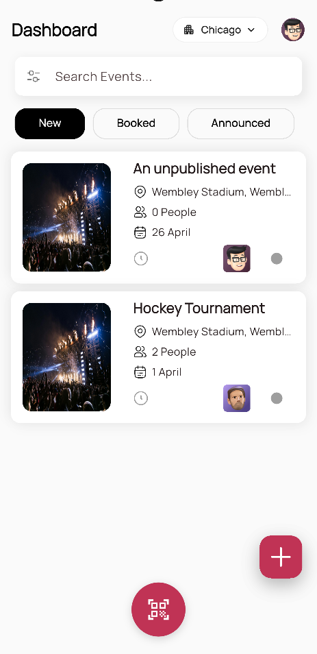
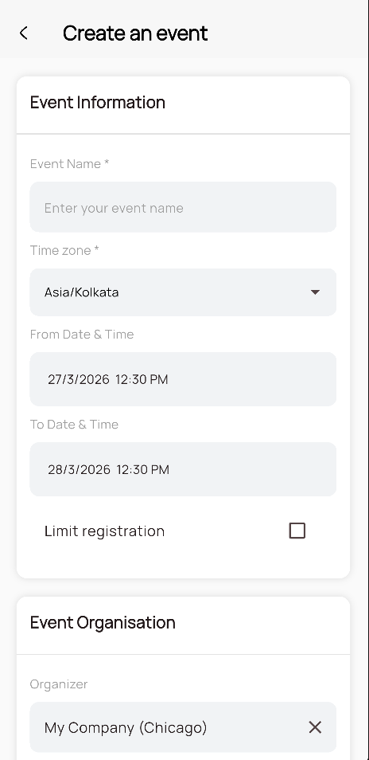
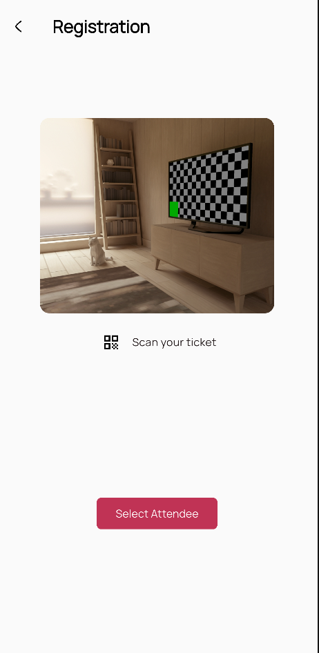
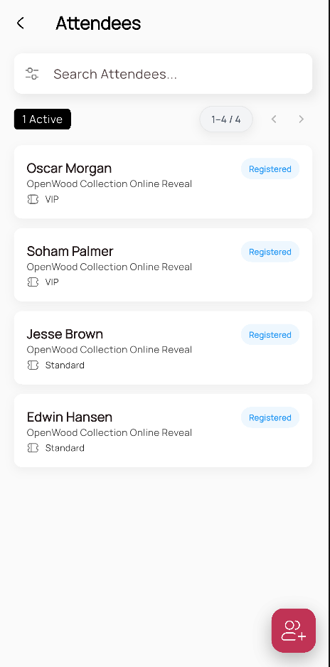
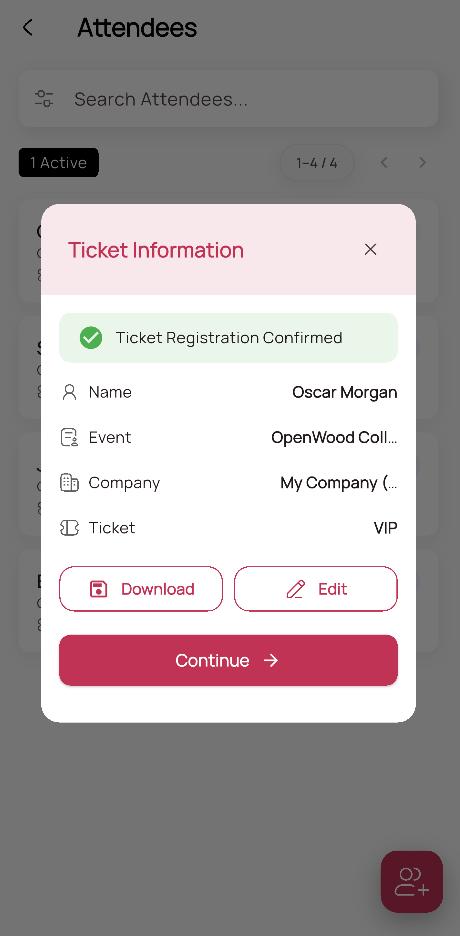

# Mobo Event

[](https://flutter.dev)
[](https://dart.dev)
[](https://www.android.com)
[](https://www.apple.com/ios)
[](https://www.odoo.com)
[](LICENSE)

**Mobo Event** is an enterprise-grade mobile application designed for professional event management. Deeply integrated with the **Odoo ERP** ecosystem, it provides a high-performance interface for tracking registrations, managing attendees, and handling complex ticketing workflows directly from Android and iOS devices.

---

## Visual Showcase

<div align="center">
  
  
  
  
  
</div>

---

## Core Features

- **Real-Time Event Tracking**: Instant synchronization with Odoo for live event status and sessions.
- **Precision Scanning**: High-fidelity QR and Barcode scanning powered by `mobile_scanner`.
- **Advanced Ticketing**: Manage tiered ticket types, seat availability, and pricing dynamically.
- **Enterprise Security**: Biometric authentication (FaceID/Fingerprint) and secure session handling.
- **Dynamic Registration**: Support for customizable event questions and feedback forms.
- **Multi-Tenant Architecture**: Seamless switching between multiple Odoo databases and companies.

---

## Project Architecture

Mobo Event follows a strict **Feature-Driven** architectural pattern, optimized for scalability and modularity.

### Directory Structure
```text
.
├── android/            # Android native platform configuration
├── ios/                # iOS native platform configuration
├── assets/             # Global assets (Images, Lottie, Fonts, Icons)
├── lib/                
│   ├── app/            # App entry point, Main Scaffold, and Initializers
│   ├── core/           # Infrastructure Layer
│   │   ├── const/      # Universal constants (Colors, Typography)
│   │   ├── services/   # Core engines (Odoo RPC, Auth, Session)
│   │   ├── routing/    # Navigator 2.0 implementation
│   │   └── theme/      # Dark & Light mode configurations
│   ├── features/       # Business Logic Layer (Modular Features)
│   │   ├── event/      # Event details and session logic
│   │   ├── ticket/     # Ticketing and seat management
│   │   └── ...         # modular login, registration, etc.
│   ├── shared/         # Common UI components & reusable data/helpers
│   └── main.dart       # Application entry point
└── test/               # Comprehensive unit and integration tests
```

### Design Principles
- **Modularity**: Every feature is self-contained with its own providers and services.
- **Reactive State**: Powered by [Provider](https://pub.dev/packages/provider) for clean data flow.
- **Clean Infrastructure**: Abstracted service layers isolate the UI from Odoo RPC complexities.

---

## Technology Stack

| Category | Technology | Usage in Mobo Event |
| :--- | :--- | :--- |
| **Core Framework** | [Flutter](https://flutter.dev) (Dart) | Multi-platform native framework. |
| **Backend Interface**| [Odoo RPC](https://pub.dev/packages/odoo_rpc) | Direct enterprise session & data management. |
| **State Management**| [Provider](https://pub.dev/packages/provider) | Pragmatic and testable state management. |
| **Authentication** | [Local Auth](https://pub.dev/packages/local_auth) | Enterprise biometric security layer. |
| **Scanning** | [Mobile Scanner](https://pub.dev/packages/mobile_scanner) | High-speed QR/Barcode check-in system. |
| **Graphics** | [Lottie](https://pub.dev/packages/lottie) | Vector-based micro-animations. |
| **Typography** | [Google Fonts](https://pub.dev/packages/google_fonts) | Optimized cross-platform typography. |
| **Local Storage** | [Secure Storage](https://pub.dev/packages/flutter_secure_storage) | Hardware-backed encrypted session storage. |

---

## Configuration & Permissions

### iOS Requirements
Add the following to your `Info.plist`:
- `NSCameraUsageDescription`: Required for scanning attendee tickets.
- `NSFaceIDUsageDescription`: Required for biometric authentication.
- `NSPhotoLibraryUsageDescription`: Required for picking event/profile images.

### Android Requirements
The app requires the following permissions in `AndroidManifest.xml`:
- `INTERNET`: For Odoo server communication.
- `CAMERA`: For QR code scanning.
- `USE_BIOMETRIC`: For Fingerprint/FaceID login.

---

## Getting Started

### Prerequisites
- **Flutter SDK**: v3.19.0 or higher.
- **Odoo Server**: v17.0+ (Community or Enterprise).
- **Backend Setup**: Ensure the `event` and `website_event` modules are installed on your Odoo instance.

### Installation & Run

1. **Clone the project**
   ```bash
   git clone https://github.com/mobo-open-source/mobo_event.git
   cd mobo_event
   ```

2. **Initialize Dependencies**
   ```bash
   flutter pub get
   cd ios && pod install && cd ..
   ```

3. **Launch**
   ```bash
   flutter run
   ```

---

## Troubleshooting

- **Pod Install Failure**: Ensure your CocoaPods version is 1.15.0 or higher. Run `pod repo update` if dependencies are not found.
- **Scanning Issues**: Verify the camera permission is enabled in the device settings.
- **Sync Failure**: Ensure the Odoo server URL starts with `https://` (unless local testing) and is accessible from the mobile network.
- **Login Issues**: Verify your database name and ensuring the user has Invoicing permissions in Odoo.

---

## Development Standards

### Commit Message Convention
To maintain a high-quality audit log, we follow the Mobo convention:
- `[ADD]`: Adding new features or critical dependencies.
- `[FIX]`: Resolving bugs or build issues.
- `[UPDT]`: Updating existing code, themes, or documentation.

### Code Quality
Run the following before submitting any pull requests:
```bash
flutter analyze
flutter test
```

---

## Future Roadmap
- [ ] **Offline Data Entry**: Queue registrations while offline for automatic sync.
- [ ] **Advanced Analytics**: Interactive dashboards for event organizers.
- [ ] **Push Notifications**: Integrated Odoo activity alerts.

---

##  Configuration
1. **Server Setup**: Enter your Odoo Server URL and Database on the login screen.
2. **Credentials**: Log in with your standard Odoo user credentials.
3. **Company Selection**: Switch between allowed companies from the profile menu.

---

## Contributing
1. Fork the repo.
2. Create your Feature Branch (`git checkout -b feature/CoolFeature`).
3. Commit using our conventions (`git commit -m '[ADD] CoolFeature'`).
4. Push to the branch.
5. Create a Pull Request.

---

## License
Licensed under the **Apache License 2.0**. See `LICENSE` for the full legal text.

**Developed with by Team Mobo at [Cybrosys Technologies](https://www.cybrosys.com)**


##  Maintainers
**Team Mobo at Cybrosys Technologies**
- Email: [mobo@cybrosys.com](mailto:mobo@cybrosys.com)
- Website: [cybrosys.com](https://www.cybrosys.com/mobo/)
